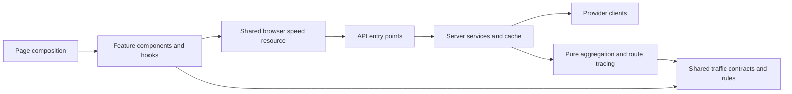

# Responsibility boundaries

The browser is a Vite/React app. Public HTTP entry points remain under `api/`; their reusable implementations live under `server/`. `shared/` holds safe cross-runtime contracts and rules. No dependency or framework migration is required.

## Browser owners

| Module | Owns |
|---|---|
| `src/views/` | Page composition and cross-feature actions |
| `src/features/traffic/speedResource.ts` | Speed-feed validation, subscriber demand, coalesced requests, one refresh listener/timer, retained data and offline provenance |
| `src/features/traffic/useSpeedFeed.ts` | React subscription and browser adapters for that resource |
| `src/utils/speedSnapshot.ts` | Local snapshot persistence and age limit |
| `src/features/cameras/cameraClient.ts` / `useCameraFeed.ts` | Provider fallback and camera refresh lifecycle |
| `src/features/cameras/normalizeCameraFeed.ts` / `cameraReadings.ts` | Camera normalization, traffic/count interpretation, weather enrichment and checkpoint summaries |
| `src/features/cameras/useCameraNavigation.ts` | Camera URL/history, saved tabs, keyboard/swipe selection and Near Me precedence |
| `CameraTile`, `CameraImage`, `CameraDialog`, `CheckpointSummary` | Camera presentation; the dialog owns modal focus/cleanup, and the image owns failed-image visibility |
| `src/features/cameras/vmsBoards.ts` | Pure VMS severity, deduplication and location enrichment |
| `src/features/radar/useRadarSources.ts` | Feed composition and corridor groupings |
| `src/features/radar/radarSelectors.ts` | Pure freshness, proximity and map-marker derivation |
| `src/features/radar/useRadarReadings.ts` | Reading composition and map-layer preference state |
| `src/features/radar/useRadarNavigation.ts` | Radar URL/tab state, keyboard controls, wall cycling and map navigation |
| Radar panel/card/map components | Rendering of their named reading/navigation subsets |
| `src/features/commutes/` | Saved-commute list, cards, editor, leg editor, pure summaries, history effect and sparkline |
| `src/features/vehicle-counting/engine.ts` | Lazy ONNX runtime/session, browser image preprocessing and vehicle inference |
| `src/features/vehicle-counting/useVehicleCounts.ts` | React queue, visibility, result lifetime and safe diagnostics |
| `src/features/app/` | Application navigation and wall-display controls |
| `src/features/sos/` | Pickup readings and demo dispatch state/fixtures |

`useSpeedFeed('summary')` requests a small payload. `full` requests current segments and checkpoint estimates. `geometry` reuses retained geometry and fetches it only until available; it adds no recurring polling once geometry is loaded. Full consumers share the resource's polling schedule. Pending requests are coalesced, including a serialized summary-to-full upgrade.

A newer summary does not relabel retained segment speeds as current: current segment data is retained only for the same source observation. Separate geometry can still label VMS locations. Offline answers keep their received time and do not renew the persisted snapshot's lifetime. A failed refresh preserves the last data with an error state.

## Server owners

| Module | Owns |
|---|---|
| `server/http/responses.ts` | Node/Web JSON responses, CORS, preflight and cache headers |
| `server/providers/lta.ts` | LTA credential resolution, proxy transport and general paginated datasets |
| `server/providers/dataGov.ts` | Wrapped data.gov.sg v2 transport and rate-limit retry |
| `server/providers/ltaSpeedPages.ts` | Speed-page retries, timeout and source timestamp metadata |
| `server/traffic/aggregateSpeeds.ts` | Incremental, pure speed summaries and geometry normalization |
| `server/traffic/traceCheckpoint.ts` | Pure directional route tracing, coverage and travel-time estimates |
| `server/traffic/speedService.ts` | Bounded page waves, complete-dataset guard, aggregation cache and concurrent-request sharing |
| `server/healthProbes.ts` | Measured probes and safe failure projection |
| `server/healthCatalogue.ts` | Health endpoint descriptions and combination of measured probes |
| `shared/healthCatalogue.ts` | Trusted endpoint identities for API and CI reporting |

The specialized speed fetcher retains its source timestamps and retry behavior. A configured page cap still refuses partial results. The public endpoint preserves summary versus `include=segments`, successful response shapes, Node/Web adapters, cache headers and safe errors.

## Import rules

- UI imports feature hooks and domain types. Shared traffic code imports neither React/DOM APIs nor server config.
- `shared/traffic/types.ts` owns speed/segment/checkpoint contracts. `shared/traffic/rules.ts` owns band values and checkpoint booth zones.
- Corridor arithmetic averages, nearby directional harmonic means and traced-route estimates remain distinct calculations.
- `config/schema.ts`, `config/client.ts`, `config/server.ts`, `config/policy.ts` and `shared/diagnostics.ts` retain their established validation and security boundaries.
- `src/data/expressways.ts` is real reference data; `demoData.ts` contains sample fixtures; `emergencyContacts.ts` owns emergency contacts.
- Compatibility exports in `api/_client.ts`, `src/data/mockData.ts`, `src/utils/vehicleDetection.ts` and `src/components/MyCommute.tsx` preserve existing callers. New code should import the specific owner.
- Keep lazy page imports and lazy model loading. Tabs retain mounted content so switching views preserves data and state.

Run `bun run lint`, `bun run test` and `bun run build` before publishing an implementation. `tests/modularity.test.ts` covers the new ownership boundaries with synthetic fixtures; the existing diagnostics/configuration/parser checks remain required.
