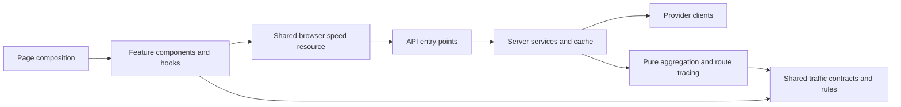

# Responsibility boundaries

The browser is a Vite/React app. Public HTTP entry points remain under `api/`; their reusable implementations live under `server/`. `shared/` holds safe cross-runtime contracts and rules. No dependency or framework migration is required.

## Browser owners

| Module | Owns |
|---|---|
| `src/views/` | Page composition and cross-feature actions |
| `src/features/traffic/speedResource.ts` | Speed-feed validation, subscriber demand, coalesced requests, one refresh listener/timer, retained data and offline provenance |
| `src/features/traffic/useSpeedFeed.ts` | React subscription and browser adapters for that resource |
| `src/features/weather/` | Shared rain polling/state, Retry-After cooldowns and retained/expired forecast notices |
| `src/features/feeds/polledResource.ts` / `useSharedFeed.ts` | Validated travel-time/air-quality snapshots retained across page mounts, shared pending requests, subscriber-owned timers/listeners and retry cooldowns |
| `src/utils/speedSnapshot.ts` | Local snapshot persistence and age limit |
| `src/features/cameras/cameraClient.ts` / `useCameraFeed.ts` | Provider fallback and camera refresh lifecycle |
| `src/features/cameras/normalizeCameraFeed.ts` / `cameraReadings.ts` | Camera normalization, traffic/count interpretation, weather enrichment and checkpoint summaries |
| `src/features/cameras/useCameraNavigation.ts` | Camera URL/history, saved tabs, keyboard/swipe selection and Near Me precedence |
| `CameraTile`, `CameraImage`, `CameraDialog`, `CheckpointSummary` | Camera presentation; the dialog owns modal focus/cleanup, and the image owns failed-image visibility |
| `src/features/cameras/vmsBoards.ts` | Pure VMS severity, deduplication and location enrichment |
| `src/features/radar/useRadarSources.ts` | Feed composition and corridor groupings |
| `src/features/radar/radarSelectors.ts` | Pure freshness, proximity and map-marker derivation |
| `src/features/radar/useRadarReadings.ts` | Reading composition and map-layer preference state |
| `src/features/radar/useRadarNavigation.ts` | Radar URL/tab state, keyboard controls, wall cycling and map navigation |
| Radar panel/card/map components | Rendering of their named reading/navigation subsets |
| `src/features/commutes/` | Saved-commute list/controller, cards, editor, leg editor, pure summaries, one history batch effect and subscribed trend/sparkline readers |
| `src/features/vehicle-counting/engine.ts` | Lazy ONNX runtime/session, browser image preprocessing and vehicle inference |
| `src/features/vehicle-counting/useVehicleCounts.ts` | React queue, visibility, result lifetime and safe diagnostics |
| `src/features/app/` | Application navigation and wall-display controls |
| `src/features/sos/` | Pickup readings and demo dispatch state/fixtures |

`useSpeedFeed('summary')` requests a small payload. `full` requests current segments and checkpoint estimates. `geometry` reuses retained geometry and fetches it only until available; it adds no recurring polling once geometry is loaded. Full consumers share the resource's polling schedule. Pending requests are coalesced, including a serialized summary-to-full upgrade.

A newer summary does not relabel retained segment speeds as current: current segment data is retained only for the same source observation. Separate geometry can still label VMS locations. Offline answers keep their received time and do not renew the persisted snapshot's lifetime. A failed refresh preserves the last data with an error state.

## Server owners

| Module | Owns |
|---|---|
| `server/http/responses.ts` | Node/Web JSON responses, CORS, preflight and cache headers |
| `server/providers/lta.ts` | LTA credential resolution, proxy transport and general paginated datasets |
| `server/providers/dataGov.ts` / `dataGovClient.ts` | Wrapped v2 transport, pending-request sharing, instance-local pacing/cooldown and bounded rate-limit retry |
| `server/weather/rainService.ts` | Validated forecasts, fresh cache, pending refreshes and validity/age-limited retention |
| `shared/weather/rain.ts` / `shared/time.ts` / `shared/httpRetry.ts` | Cross-runtime forecast validation, Singapore timestamp parsing and safe retry timing |
| `shared/traffic/incidents.ts`, `cameras.ts`, `validation.ts` | Cross-runtime incident/camera contracts, safe JSON parsing and pure camera normalization; see [JSON examples](docs/api/lta-traffic.md) |
| `shared/geography/` | NEA reference coordinates, expressway area footprints, distance calculations and explicit hazard-matching results |
| `server/providers/ltaSpeedPages.ts` | Speed-page retries, timeout and source timestamp metadata |
| `server/traffic/aggregateSpeeds.ts` | Incremental, pure speed summaries and geometry normalization |
| `server/traffic/traceCheckpoint.ts` | Pure directional route tracing, coverage and travel-time estimates |
| `server/traffic/speedService.ts` | Bounded page waves, complete-dataset guard, aggregation cache and concurrent-request sharing |
| `server/healthProbes.ts` | Measured probes and safe failure projection |
| `server/healthCatalogue.ts` | Health endpoint descriptions and combination of measured probes |
| `shared/healthCatalogue.ts` | Trusted endpoint identities for API and CI reporting |

The specialized speed fetcher retains its source timestamps and retry behavior. A configured page cap still refuses partial results. The public endpoint preserves summary versus `include=segments`, successful response shapes, Node/Web adapters, cache headers and safe errors.

## Import rules

- UI imports feature hooks and domain types. Shared traffic code imports neither React/DOM APIs nor server config.
- `shared/traffic/types.ts` owns speed/segment/checkpoint contracts. `shared/traffic/rules.ts` owns band values and checkpoint booth zones.
- Corridor arithmetic averages, nearby directional harmonic means and traced-route estimates remain distinct calculations.
- `config/schema.ts`, `config/client.ts`, `config/server.ts`, `config/policy.ts` and `shared/diagnostics.ts` retain their established validation and security boundaries.
- `src/data/expressways.ts` is real reference data; `demoData.ts` contains sample fixtures; `emergencyContacts.ts` owns emergency contacts.
- Compatibility exports in `api/_client.ts`, `src/data/mockData.ts`, `src/utils/vehicleDetection.ts` and `src/components/MyCommute.tsx` preserve existing callers. New code should import the specific owner.
- Keep lazy page imports and lazy model loading. Main pages mount conditionally and unmount when navigation changes. Camera subtabs retain hidden content for quick switching; shared speed, rain, travel-time and air-quality resources retain useful data across subscriptions.

Run `bun run lint`, `bun run test` and `bun run build` before publishing an implementation. `tests/modularity.test.ts` covers the new ownership boundaries with synthetic fixtures; the existing diagnostics/configuration/parser checks remain required.

Weather retry/cache behavior and its per-instance limits are documented in [WEATHER_FEEDS.md](WEATHER_FEEDS.md). `tests/weather-reliability.test.ts` covers pacing, provider cooldowns, cache age/expiry, retained response headers and shared browser polling.

For the remaining UI/domain/data-access seams after PRs #6 and #7, see [LAYERING_REVIEW.md](LAYERING_REVIEW.md). It is a proposed plan, not an implemented folder reorganization.

For repeated HTTP acquisition and browser history writes, see [N_PLUS_ONE_REVIEW.md](N_PLUS_ONE_REVIEW.md). It distinguishes page-remount refetches and per-card persistence from SQL N+1 queries, intentional pagination and local image inference.

Travel-time and air-quality hooks now use module-owned browser resources. A recent completed observation is immediately reusable on remount with its original receipt/source times. An expired refresh deadline starts one shared request; no subscriber means no polling timer or refresh listener. Failed validation/requests retain the last valid observation with the existing loading/error behavior. Offline replies retain their cached receipt time and cannot replace a known observation; failures retry on the configured retry interval and respect numeric Retry-After cooldowns. These are in-memory browser caches, not persistent stores or new server caches. Existing speed/rain resources keep their specialized demand/forecast policies.

## Independent hazard geography

`shared/geography/forecastAreas.ts` contains the 47 NEA area names/coordinates acquired from the official two-hour endpoint's `area_metadata` on 20 October 2026. It stores no forecast wording or validity and needs no runtime fetch, cache or subscriber. The data is a versioned reference catalogue; future provider coordinate/name changes require a reviewed catalogue refresh and an updated `verifiedOn` date.

`hazardMatching.ts` accepts plain coordinates and a reference catalogue. It imports neither React nor configuration/provider clients. Results distinguish ready (possibly no matches) from unavailable (missing feed or unusable geography). An empty known hazard list needs no geography to establish no events. Incomplete/duplicate/invalid catalogues cannot establish no nearby hazards when events exist.

Radar composition uses this catalogue even when rain is expired, failed or never loaded. Weather presentation handles unavailable matching explicitly; raw hazard markers and flood descriptions retain their existing path. Rain validity still controls prediction text only. Existing approximate matching is preserved: lightning within 5 km of town-centre areas along a road; flood circles within an additional 1.5 km. This does not establish exact road intersection.

To refresh the reference data, inspect the official `area_metadata`, retain only name/latitude/longitude, review the coordinate changes, update source verification date, and run the coverage/matching tests. Keep the existing road-to-area associations separate from the current prediction payload.

## Data model review

See [DATA_MODEL_REVIEW.md](DATA_MODEL_REVIEW.md) for the source-based review of commute history, storage contracts, route connectivity, asset/observation identity, demo dispatch relationships and ERP versioning. It documents confirmed synthetic cases and a proposed implementation order; it does not change the running model or provision a database.

## Commute storage integrity

`shared/commutes/model.ts` owns saved-data validation and route keys. The injected `commuteRepository.ts` owns versioned storage, recovery, commands and route-specific history; `commuteStorage.ts` supplies browser storage/catalogue access. The list/controller derives summaries once and records all eligible receipts through `recordBatch`; unchanged histories skip writes/publications, except that a failed history write can retry and clear its own notice. Existing utility exports delegate to this repository. `useCommuteHistory` only selects the current route directly from its subscribed state. See [COMMUTE_STORAGE.md](COMMUTE_STORAGE.md) for the non-destructive migration, protected-store behavior and remaining scope.

Released through [PR #10](https://github.com/Mikazukiangus/live-traffic/pull/10) with explicit approval on 21 October 2026. Persisted route revisions prevent prior history from returning after partial storage failures; later data-model slices remain separate work.
