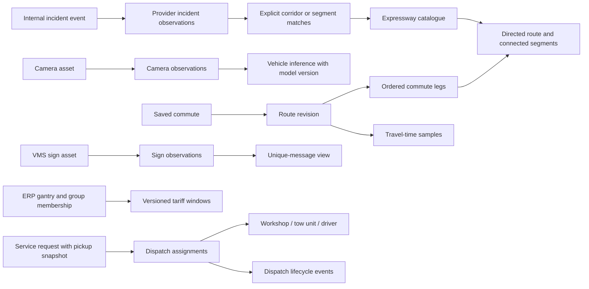

# TrafficPulse data model review

Reviewed **20 October 2026, SGT**, against main **a08c607**. This is a source review and synthetic verification, with proposed changes only. No application behavior or stored user data was changed.

## Scope and conclusion

TrafficPulse has no connected SQL database according to the repository and Vercel checks recorded in Turns 100–101. Its current model consists of provider payloads, validated shared contracts, UI models, browser storage and demo dispatch objects. Accordingly, “missing relationships” below describes links the application does not model explicitly; it does not claim that an existing database is missing foreign keys.

**Fix saved commute/history integrity and route continuity first.** They already affect correctness. Before persisting historical data or operating a real dispatch service, give events, observations and assignments separate identities and preserve source timestamps. A database migration is not required for the first fixes.

## Findings, in priority order

### 1. P2 — A commute's identity survives a route edit, but its history has no route revision

**Evidence:** [editor save](https://github.com/Mikazukiangus/live-traffic/blob/a08c607197aa1a6f5d38f188ea49026721827503/src/features/commutes/CommuteEditor.tsx#L24), [saveCommute](https://github.com/Mikazukiangus/live-traffic/blob/a08c607197aa1a6f5d38f188ea49026721827503/src/utils/commutes.ts#L55), [history shape and key](https://github.com/Mikazukiangus/live-traffic/blob/a08c607197aa1a6f5d38f188ea49026721827503/src/utils/commuteHistory.ts#L11), [history hook](https://github.com/Mikazukiangus/live-traffic/blob/a08c607197aa1a6f5d38f188ea49026721827503/src/features/commutes/useCommuteHistory.ts#L3), [card wiring](https://github.com/Mikazukiangus/live-traffic/blob/a08c607197aa1a6f5d38f188ea49026721827503/src/features/commutes/CommuteCard.tsx#L41).

`Commute` owns `legs`, but `History` is keyed only by `commuteId`. Saving changed legs preserves that ID and does not clear or version samples. Each sample has only `[at, minutes]`; there is no record of the route it measured. The hook/card also retain their sample state across an edit of the same ID.

**Confirmed with synthetic inputs:** save a 30-minute PIE route, edit that commute to a 10-minute AYE route, then record a sample 30 minutes later. The existing helper combines both samples and reports **easing by 20 minutes**, despite measuring different routes. This is a current correctness issue, not a forecast of a future database problem.

**Recommended model:** `Commute(id, name, alerts, routeRevision)` → ordered `CommuteLeg` records; `CommuteSample(commuteId, routeRevision, observedAt, receivedAt, minutes, source)`. Increment the revision only when ordered route-defining fields change. A rename or notification toggle must not invalidate history. For the small browser store, clearing history and resetting hook state on a route change is a reasonable first implementation; revisioned history is better if it must be retained.

### 2. P2 — Saved records have no validated, versioned storage contract

**Evidence:** [commute read](https://github.com/Mikazukiangus/live-traffic/blob/a08c607197aa1a6f5d38f188ea49026721827503/src/utils/commutes.ts#L28), [history read](https://github.com/Mikazukiangus/live-traffic/blob/a08c607197aa1a6f5d38f188ea49026721827503/src/utils/commuteHistory.ts#L14), [history use](https://github.com/Mikazukiangus/live-traffic/blob/a08c607197aa1a6f5d38f188ea49026721827503/src/utils/commuteHistory.ts#L24), [commute traversal](https://github.com/Mikazukiangus/live-traffic/blob/a08c607197aa1a6f5d38f188ea49026721827503/src/utils/commutes.ts#L58).

The commute loader checks only `Array.isArray`. The history loader accepts any non-null object, including arrays and values whose entries are not sample arrays. TypeScript interfaces do not validate JSON loaded from an older app version or modified browser storage. Parse errors are caught, but valid JSON with the wrong shape reaches later code.

**Confirmed:** a saved commute `{ "id": "broken" }` throws when its missing legs are traversed. A history entry `{ "review-route": { "invalid": true } }` throws in `recordSample` when `.filter` is called. These were isolated in-memory fixtures, not the user's browser data.

**Recommended model:** independent envelopes such as `{schemaVersion: 1, commutes: [...]}` and `{schemaVersion: 1, samplesByRoute: ...}`. Validate IDs, nonblank names, unique IDs, leg mode/direction/endpoints, finite nonnegative times/minutes and ordering. Migrate known versions explicitly. Reject unknown incompatible versions safely; avoid rewriting or silently deleting unreadable data on load. Keep valid entries where that recovery policy is clear. Enforce the same domain rules on writes, not only in the form.

### 3. P2 — Route connectivity is implied by names and response order

**Evidence:** [CommuteLeg](https://github.com/Mikazukiangus/live-traffic/blob/a08c607197aa1a6f5d38f188ea49026721827503/src/utils/commutes.ts#L10), [TravelRoute](https://github.com/Mikazukiangus/live-traffic/blob/a08c607197aa1a6f5d38f188ea49026721827503/src/utils/ltaTravelTimes.ts#L19), [groupStretches](https://github.com/Mikazukiangus/live-traffic/blob/a08c607197aa1a6f5d38f188ea49026721827503/src/utils/ltaTravelTimes.ts#L43), [minutesBetween](https://github.com/Mikazukiangus/live-traffic/blob/a08c607197aa1a6f5d38f188ea49026721827503/src/utils/ltaTravelTimes.ts#L55), [editor completeness](https://github.com/Mikazukiangus/live-traffic/blob/a08c607197aa1a6f5d38f188ea49026721827503/src/features/commutes/CommuteEditor.tsx#L21).

Saved endpoints are formatted place-name strings. `groupStretches` keeps provider row order inside each direction. `minutesBetween` finds a start, sums subsequent rows and stops when an end name matches, without checking that each preceding `to` equals the next `from`. `direction: number` also represents both real directions and the `0` sentinel for an estimated whole-road leg.

**Confirmed:** shuffled connected rows `B→C (2 min), A→B (1 min)` return null for A→C. Disconnected rows `A→B (1 min), C→D (2 min)` return **3 minutes** for A→D. This proves an input-order/continuity weakness, not that current LTA responses were observed out of order.

**Recommended model:** route identity includes provider, expressway and direction. Nodes retain raw provider names and a reviewed alias mapping; assign internal IDs where the provider offers no stable point ID. Directed edges connect `fromNodeId` to `toNodeId` with validated minutes and a source snapshot identity. Validate/order a unique connected path, and return unavailable for gaps, ambiguity or loops. Do not invent stable provider IDs.

Use a discriminated leg type: `published-route` with direction/endpoints versus `whole-expressway-estimate` with code. Preserve ordered legs. Add `legId` if legs will be individually edited, synchronized or persisted as rows. Incident matching is currently intentionally corridor-wide; exact route/direction alerts would need an explicit event-to-segment/path match with a stated confidence, not just the current corridor code.

### 4. P2 before real dispatch — One object combines a request, provider, customer vehicle and assignment

**Evidence:** [ActiveDispatch](https://github.com/Mikazukiangus/live-traffic/blob/a08c607197aa1a6f5d38f188ea49026721827503/src/types/traffic.ts#L65), [booking state and builder](https://github.com/Mikazukiangus/live-traffic/blob/a08c607197aa1a6f5d38f188ea49026721827503/src/components/BookingModal.tsx#L21), [demo builder](https://github.com/Mikazukiangus/live-traffic/blob/a08c607197aa1a6f5d38f188ea49026721827503/src/features/sos/demoDispatch.ts#L2), [dispatch lifecycle state](https://github.com/Mikazukiangus/live-traffic/blob/a08c607197aa1a6f5d38f188ea49026721827503/src/features/sos/useDemoDispatch.ts#L4).

There are no `workshopId`, `customerVehicleId`, `driverId`, `towUnitId` or assignment/event links. Names, phones and plates are copied into each dispatch. Some copies should eventually be immutable booking snapshots; others identify current entities. The model does not distinguish those uses.

Concrete issues:

- `specialRemarks` is collected by the form but has no place in `ActiveDispatch` and is dropped during construction. This is current demo data loss; no real booking backend exists.
- The demo builder puts an assigned tow plate into `vehiclePlate`, while the booking builder uses that field for the customer's plate. `truckPlate` separately holds the tow plate. The same field has incompatible meanings.
- `createdAt` is a locale-formatted time string, with no date/timezone. It cannot reliably order events across days or viewers. `locationMarker` is only display text; the selected pickup's coordinates are not part of the dispatch snapshot.
- IDs truncate the clock. The demo `EMAS-` suffix repeats after 100 seconds; the booking `DSP-` suffix repeats after 1,000 seconds. The former was reproduced with a synthetic clock. These are unsuitable persistent identifiers.
- `isBroadcasting` and `activeDispatch.step` are separate state authorities. The toggle can produce an active assigned/en-route object while broadcasting is false; this may represent a UI control, but the distinction must be explicit before it becomes an operational lifecycle.

**Recommended model:** `ServiceRequest` owns customer contact/vehicle snapshots, pickup coordinates and label, remarks, requested service and a real UTC instant. `DispatchAssignment` links request, workshop, tow unit and driver; retain immutable quoted/contact snapshots where needed. `DispatchEvent` records lifecycle changes and their times. Use collision-resistant IDs; use an explicit demo/live discriminator. Derive UI booleans from lifecycle state where they mean the same thing. Monetary quotes should carry currency, integer minor-unit amounts, quote scope and a validity/version rather than `costText` alone. Keep this as a demo until a real service is deliberately designed.

### 5. P2 before historical incident reporting — Incident content identity and event identity are conflated

**Evidence:** [raw incident contract](https://github.com/Mikazukiangus/live-traffic/blob/a08c607197aa1a6f5d38f188ea49026721827503/shared/traffic/incidents.ts#L3), [parsed timestamp](https://github.com/Mikazukiangus/live-traffic/blob/a08c607197aa1a6f5d38f188ea49026721827503/src/utils/ltaIncidents.ts#L76), [fingerprint](https://github.com/Mikazukiangus/live-traffic/blob/a08c607197aa1a6f5d38f188ea49026721827503/src/utils/ltaIncidents.ts#L124), [mapped alert](https://github.com/Mikazukiangus/live-traffic/blob/a08c607197aa1a6f5d38f188ea49026721827503/src/utils/ltaIncidents.ts#L133), [IncidentAlert](https://github.com/Mikazukiangus/live-traffic/blob/a08c607197aa1a6f5d38f188ea49026721827503/src/types/traffic.ts#L92).

The provider supplies no incident ID. Current IDs hash type, coordinates and the entire message into 32 bits. They correctly survive response reordering, but an edited message creates a new identity. A synthetic lane-text edit changed the ID. The parsed `reportedAt` is dropped from `IncidentAlert`, which retains a preformatted `timeAgo` instead. That label is computed when the mapping runs; it is not a durable observation time.

**Recommendation:** distinguish a snapshot fingerprint from an internal event ID. Persist raw provider type/message, parsed nullable `reportedAt` plus parse quality, `firstSeenAt`, `lastSeenAt`, observation receipt time and revision/content fingerprint. Derive age and corridor display name for UI use. If cross-snapshot event reconciliation is introduced, define its spatial/time/type matching policy and uncertainty; do not assume two nearby reports are one event. Use a stronger fingerprint when retaining large histories, and account for collisions. A report disappearing from a failed or incomplete feed is not evidence that it resolved.

### 6. P2 before frame history — A signed URL identifies a transport location, not a camera observation

**Evidence:** [normalized contract](https://github.com/Mikazukiangus/live-traffic/blob/a08c607197aa1a6f5d38f188ea49026721827503/shared/traffic/cameras.ts#L4), [capture-time fallback](https://github.com/Mikazukiangus/live-traffic/blob/a08c607197aa1a6f5d38f188ea49026721827503/shared/traffic/cameras.ts#L124), [camera view model](https://github.com/Mikazukiangus/live-traffic/blob/a08c607197aa1a6f5d38f188ea49026721827503/src/features/cameras/normalizeCameraFeed.ts#L9), [vehicle result identity](https://github.com/Mikazukiangus/live-traffic/blob/a08c607197aa1a6f5d38f188ea49026721827503/src/features/vehicle-counting/useVehicleCounts.ts#L4), [stale display](https://github.com/Mikazukiangus/live-traffic/blob/a08c607197aa1a6f5d38f188ea49026721827503/src/features/cameras/CameraTile.tsx#L16).

`CameraCard.id` embeds the source ID in `lta-live-…`; consumers later remove that prefix to recover the raw ID. Vehicle counts retain `imageUrl` and match on exact URL. This correctly prevents using a result from a different URL, but renewed signatures can give the same frame a different URL. There is no independent frame/observation identity, model version or inference time for future analysis.

The new validators reject malformed embedded dates. However, when a DataMall filename contains no timestamp, its observation timestamp falls back to request time. The model has no `timestampOrigin`, so the UI cannot distinguish a verified capture time from that fallback. This is a documented existing limitation, not a newly observed stale camera.

**Recommendation:** `Camera(provider, externalId)` → `CameraObservation(observationId, cameraId, capturedAt?, receivedAt, timestampOrigin, imageLocator, locatorExpiresAt?)` → `VehicleInference(observationId, modelVersion, inferredAt, count, calibrationVersion?)`. Use provider frame identity or a canonical object/path identity where trustworthy; never discard parameters needed to fetch a signed image. If no stable frame identity is available, say so. Keep short-lived locators out of permanent identity and diagnostic output. Introduce explicit source/capture provenance before using these timestamps as history. Avoid storing images unless that is a separately approved feature.

### 7. P3 — Reference keys and display fields have several competing representations

**Evidence:** [expressway catalogue](https://github.com/Mikazukiangus/live-traffic/blob/a08c607197aa1a6f5d38f188ea49026721827503/src/data/expressways.ts#L3), [provider aliases](https://github.com/Mikazukiangus/live-traffic/blob/a08c607197aa1a6f5d38f188ea49026721827503/server/traffic/aggregateSpeeds.ts#L5), [travel-time code list](https://github.com/Mikazukiangus/live-traffic/blob/a08c607197aa1a6f5d38f188ea49026721827503/src/utils/ltaTravelTimes.ts#L33), [camera metadata](https://github.com/Mikazukiangus/live-traffic/blob/a08c607197aa1a6f5d38f188ea49026721827503/src/data/cameras.ts#L4), [pickup coordinates](https://github.com/Mikazukiangus/live-traffic/blob/a08c607197aa1a6f5d38f188ea49026721827503/src/types/traffic.ts#L9), [shared coordinates](https://github.com/Mikazukiangus/live-traffic/blob/a08c607197aa1a6f5d38f188ea49026721827503/shared/geography/coordinates.ts#L1), [camera UI defaults](https://github.com/Mikazukiangus/live-traffic/blob/a08c607197aa1a6f5d38f188ea49026721827503/src/features/cameras/normalizeCameraFeed.ts#L20), [workshop model](https://github.com/Mikazukiangus/live-traffic/blob/a08c607197aa1a6f5d38f188ea49026721827503/src/types/traffic.ts#L16).

- Most relationships use unconstrained `code: string`, with provider aliases and supported-code lists maintained separately. One name/case change can stop a join. Aliases such as the KPE tunnel are legitimate provider differences; consolidate ownership without removing them. The travel-time formatter also knows `NSC`, so a strict internal catalogue needs an explicit future/unknown-road path rather than rejecting new provider values indiscriminately.
- Coordinates use `lat/lon`, `lat/lng`, provider `Latitude/Longitude`, and speed tuples `[code, band, startLon, startLat, endLon, endLat]`. Boundary adapters are necessary, but the internal convention should reuse shared `Coordinates`; tuple field order needs labels and a version.
- `IncidentAlert` carries corridor name and code; camera cards carry formatted `updatedTime` alongside `capturedAt`, plus placeholder `weather: 'Dry'` and `speedStatus: ''`. These presentation fields are unnecessary persistence columns. There is no evidence that the unused default weather currently overrides NEA readings.
- Workshop `statusBadge`, `isOpen247`, `baysAvailableText`, fixed distance and `fromMarker` mix static directory information with live availability and pickup-relative results. They are currently demo fixtures, not authoritative operational facts. Future availability needs timestamps/source and numeric structured capacity; distance must be computed for a specific pickup. Display badges should be derived.

**Recommendation:** one browser/server-safe expressway catalogue with typed internal keys and explicit provider aliases; reuse `{lat, lon}` internally. Keep provider DTOs and UI projections separate. Retain deliberate display duplication at the projection boundary, not as independently mutable canonical facts. For wire tuples, document named positions and add a version before evolving their layout.

### 8. P3 before tariff history or exact route costing — ERP gantry groups and schedules have no independent identities

**Evidence:** [ERP group/slot types](https://github.com/Mikazukiangus/live-traffic/blob/a08c607197aa1a6f5d38f188ea49026721827503/src/data/erpRates.ts#L15), [multi-gantry group](https://github.com/Mikazukiangus/live-traffic/blob/a08c607197aa1a6f5d38f188ea49026721827503/src/data/erpRates.ts#L43), [current corridor filter](https://github.com/Mikazukiangus/live-traffic/blob/a08c607197aa1a6f5d38f188ea49026721827503/src/utils/erp.ts#L73), [formatted note rewriting](https://github.com/Mikazukiangus/live-traffic/blob/a08c607197aa1a6f5d38f188ea49026721827503/src/utils/erp.ts#L14).

`gantryNos` is a comma-separated string and one row can represent several physical gantries. One global effective date/source and a mutable current schedule are sufficient for today's display but cannot represent past revisions or group membership changes. `erpOn` explicitly reports charging gantries on the same expressway in either direction; that is not evidence that a saved partial route crosses a gantry.

**Recommendation:** distinguish physical `ErpGantry`, `ErpGroup` membership and `TariffVersion`. Keep source, effective start/end, day-rule/calendar version, vehicle class and non-overlapping time windows. Amounts should have an explicit currency/rounding policy before being used for accounting. Return structured `nextRate`/`until` fields instead of recovering monetary values from presentation prose. Exact commute charges require route direction/geometry and gantry crossing relationships. Do not present the existing corridor advisory as a precise trip charge. No current rate error was established by this review.

## Relationships to preserve or introduce

The following is a proposed logical model, not a deployed schema. First use these boundaries in TypeScript and browser storage; create database tables only when a concrete reporting/synchronization requirement is approved.

**VMS deserves its own asset/observation relationship:** [VMS input and grouping](https://github.com/Mikazukiangus/live-traffic/blob/a08c607197aa1a6f5d38f188ea49026721827503/src/features/cameras/vmsBoards.ts#L7) already preserve equipment IDs and coordinates in each grouped board. Keep that useful behavior. `VmsBoard.id = message` is appropriate for a deduplicated screen row; it is not a physical sign ID. A future history should key observations by sign identity and time, retaining full raw message; derive unique-message groups for display. Do not merge different physical signs merely because their messages match.

A future shared store also needs an explicit owner relationship for saved commutes. Today browser-only scope is deliberate. Add a local profile/device identity or authenticated user relationship only when synchronization is required, with an ownership migration; do not invent user accounts for the current app.

### Model invariants for an implementation

- Never compare history across route revisions. Repeated ingestion must not duplicate a source observation just because it was polled again; keep `observedAt` distinct from `receivedAt`.
- A published-route leg references a connected directed path; an estimate has an explicit method and scope. Missing data is not a zero-minute trip or an empty confirmed incident list.
- Asset identity, event identity, observation identity and display-group identity are different keys. Preserve raw provider identity and explicit source namespaces.
- Canonical data owns UTC instants, coordinates, structured money and lifecycle states. Formatting happens at the UI edge in Asia/Singapore. Day-only ERP rules remain local calendar dates, not fake UTC observations.
- Keep source-appropriate uniqueness rules: commute ID, `(commuteId, routeRevision, sourceObservationId)`, `(provider, externalCameraId)`, frame/inference identity, sign/time observations and tariff membership/windows. A timestamp alone is not automatically a unique event key. Database indexes must follow the approved queries and measured plans; none are being added here.
- Validate and version stored data as well as network responses. Unknown future provider values should have an explicit fallback path, not silently corrupt references.

## Duplication that should remain

Separate provider DTOs, domain contracts and UI view models are useful. Raw LTA capitalization does not have to match the app's internal field names. Do not collapse these boundaries into one large type. The recent shared incident/camera validators and independent reference geography are improvements to retain. Band speed rules already have a shared owner. Read-only names or formatted labels in derived views are acceptable; immutable price/contact snapshots can also be intentional audit data if their provenance is explicit.

The small speed snapshot and service-worker cache are delivery fallbacks, not historical databases. Rain issue/update/validity/delivery metadata already models separate clocks; preserve that distinction rather than replacing it with a generic `updatedAt` everywhere.

## Recommended implementation sequence

1. **First preview:** validate/version saved commute and history JSON; recover safely; invalidate/reset samples on route-defining edits while preserving history for renames/alert toggles. Keep existing three-commute/four-leg UX and browser-only storage.
2. **Second preview:** model and validate connected directed travel-time routes; introduce endpoint aliases and explicit estimated-leg variants, preserving saved-leg migration and returning unavailable for broken paths.
3. **Third preview:** add incident/camera observation timestamps and provenance without changing signed URLs or inventing provider identities. Keep current notification and offline behaviors explicit; review identity changes carefully.
4. **Before real bookings or historical persistence:** split requests/assignments/events, keep remarks and pickup snapshots, replace truncated IDs/localized timestamps, and structure quotes. Add tariff/asset history only for an approved feature.

Each implementation needs its own preview review and explicit main merge approval. This review does not authorize provisioning a database or operating a live dispatch service.

## Verification and limits

- Read current source/types/storage paths and traced consumers before classifying duplication. Database absence/integration details rely on the immediately preceding project/Vercel discovery; no fresh remote account or provider reads were needed for this review.
- Executed isolated native Node/TypeScript helper checks with an in-memory localStorage stub. Confirmed route-edit history mixing, two malformed-storage failures, shuffled/disconnected stretch behavior, incident identity changes/dropped parsed timestamp, and the demo ID repeat. No browser user storage, live APIs, database, images, bookings or notification permissions were accessed.
- Booking remarks loss, duplicate dispatch meanings, timestamp formats, VMS/ERP relationships and signed-URL identity concerns are from source inspection. They were not tested against an operational booking backend or alleged to be observed production incidents.
- No application code, dependencies, settings, database or test suite changed. The full test/build suite was not rerun for this documentation-only review; historical 95-test release results are not presented as new verification.

## First implementation preview

The first slice is implemented on `codex/commute-storage-integrity`: validated/versioned browser storage, non-destructive legacy recovery, current-route history invalidation and visible storage notices. See [COMMUTE_STORAGE.md](COMMUTE_STORAGE.md) for migration and limits. Draft [PR #10](https://github.com/Mikazukiangus/live-traffic/pull/10) is verified and pending explicit main merge approval; the path-connectivity and other later slices remain proposals. Historical source links above now point to the reviewed commit so line references remain valid after implementation.
