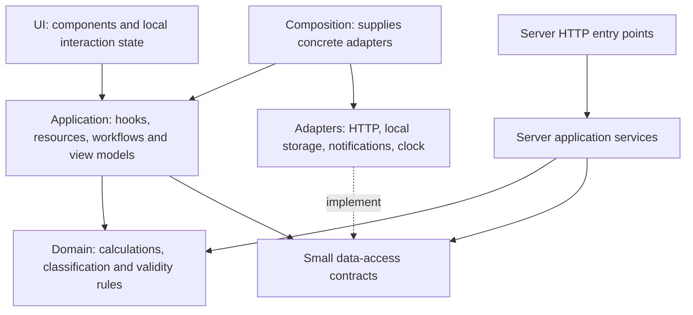

# UI, business logic and data access: layer review

Reviewed 20 October 2026 against `bb5bfd6` on `main`, after PRs #6 and #7. This document proposes changes; no application code was changed. Source links below are pinned to that reviewed revision.

## What is already separated

The earlier refactor is in place. `App.tsx` and the camera/radar pages compose feature modules; speed and rain have shared browser resources; provider clients and HTTP helpers live under `server/`; shared traffic/weather contracts already exist. The next work should finish specific boundaries rather than repeat the previous refactor.

Useful existing examples:

- [useSpeedFeed](https://github.com/Mikazukiangus/live-traffic/blob/bb5bfd6/src/features/traffic/useSpeedFeed.ts#L7) supplies browser adapters to a resource that accepts dependencies.
- [rainService](https://github.com/Mikazukiangus/live-traffic/blob/bb5bfd6/server/weather/rainService.ts#L40) owns caching and refresh orchestration with injected acquisition/time dependencies.
- [shared rain validation](https://github.com/Mikazukiangus/live-traffic/blob/bb5bfd6/shared/weather/rain.ts#L19) has no React or provider credentials.
- [cameraClient](https://github.com/Mikazukiangus/live-traffic/blob/bb5bfd6/src/features/cameras/cameraClient.ts#L10) is separate from the camera polling hook and rendered image.

## Clean boundaries to aim for

These are dependency directions. Data returns from adapters through application state/selectors to the UI. Keep provider credentials and server configuration on the server. Most feature hooks can be the application layer; a new framework or state library is unnecessary.

**UI** decides how values look and handles local state such as an open dialog or selected tab. **Domain** decides what values mean. **Application** coordinates a use case, request lifecycle and freshness. **Data access** performs HTTP, persistence or platform operations and translates external formats into typed data.

For example, `<WeatherOutlook24hView forecast={...} status={...} />` renders a view model; `useForecast24h()` owns its subscription; a client loads/validates the response. A classification function takes plain inputs and returns plain results. It does not import that hook.

## 1. Separate geographic reference data from live forecast validity — first

**Where:** [useRadarSources:34](https://github.com/Mikazukiangus/live-traffic/blob/bb5bfd6/src/features/radar/useRadarSources.ts#L34), [hazard composition:48](https://github.com/Mikazukiangus/live-traffic/blob/bb5bfd6/src/features/radar/useRadarSources.ts#L48), [lightningByExpressway:37](https://github.com/Mikazukiangus/live-traffic/blob/bb5bfd6/src/utils/weatherAlerts.ts#L37), [floodsByExpressway:48](https://github.com/Mikazukiangus/live-traffic/blob/bb5bfd6/src/utils/floodAlerts.ts#L48), and [WeatherPanel:197](https://github.com/Mikazukiangus/live-traffic/blob/bb5bfd6/src/features/radar/WeatherPanel.tsx#L197).

**Mixed responsibilities:** the weather application hook uses the current rain forecast as both a valid prediction and the location catalogue for other hazard feeds. When it expires, `rainForecast` becomes null and its area coordinates disappear from lightning/flood corridor matching. The matchers return empty objects when coordinates are unavailable; the lightning panel can then describe strikes as being elsewhere rather than acknowledge that matching was unavailable. Raw hazard markers and the raw flood list are separate and are not necessarily removed.

**Evidence:** a synthetic strike and flood alert at Woodlands match SLE/BKE with supplied area coordinates. The same inputs produce no corridor matches without those coordinates. This was checked with the current pure helpers, without a provider request. The UI consequence follows from source inspection; no production outage was simulated in this review.

**Split:**

- A geographic adapter/resource owns validated `{name, lat, lon}` reference areas independently of forecast wording and forecast validity. Retain known coordinates separately or use a reviewed versioned reference catalogue.
- Pure `shared/geography/` helpers accept coordinates/road footprints, not a `RainForecast` object or React hook module.
- Rain validity continues to expire prediction text; it does not invalidate previously acquired geography.
- Hazard selectors return a result such as `{status: 'ready' | 'unavailable', byCode}`. An empty ready result means no matches; an unavailable result means the app cannot make that claim.
- Keep the existing approximation explicit: these are town-centre footprints, not exact road geometry.

**Verification when implemented:** valid strike/alert plus expired rain still matches with retained geography; no geography shows matching unavailable; a genuinely empty hazard feed remains distinct; raw hazard markers still render.

## 2. Move provider interpretation out of HTTP handlers

**Where:** [api/_floods.ts:36](https://github.com/Mikazukiangus/live-traffic/blob/bb5bfd6/api/_floods.ts#L36) resolves alerts/cancellations/expiry; [line 86](https://github.com/Mikazukiangus/live-traffic/blob/bb5bfd6/api/_floods.ts#L86) fetches dated pages; [line 108](https://github.com/Mikazukiangus/live-traffic/blob/bb5bfd6/api/_floods.ts#L108) sends HTTP responses. [api/_roadconditions.ts:24](https://github.com/Mikazukiangus/live-traffic/blob/bb5bfd6/api/_roadconditions.ts#L24) combines road-name matching, date rules, acquisition and response handling. Air quality, 24-hour forecasts and weather alerts retain similar inline provider-to-app mapping.

**Mixed responsibilities:** one module knows the provider's raw shape, the app's interpretation, pagination, credentials, cache headers and error transport. Pure flood tests currently import the API module, which also imports server configuration.

**Split:**

- `server/providers/pubFloods.ts`: acquire pages and normalize provider records into typed alert/cancel events. Take the requested date range/page bounds as inputs.
- `shared/floods/resolveActiveAlerts.ts`: pure cancellation, ordering and expiry rules over normalized events, with explicit `now`.
- `server/floods/floodService.ts`: choose the lookback, call the adapter and rules, return the application result.
- `api/_floods.ts`: preflight, invoke the service, send safe JSON/status/cache headers.
- Apply the same pattern to road conditions and the remaining weather transformations one endpoint at a time. Share response contracts where both runtimes consume them; keep raw provider types beside their adapters.

Preserve `/api/live?feed=...`, Node/Web response support, partial-result semantics, safe diagnostics and no-store failures. Helpers belong under `server/` or `shared/`, not new public API entry points. Existing flood tests should import the domain function; keep adapter tests for provider fields and HTTP tests for transport behavior.

## 3. Finish separating the demo booking workflow from the modal

**Where:** [BookingModal:29](https://github.com/Mikazukiangus/live-traffic/blob/bb5bfd6/src/components/BookingModal.tsx#L29), [useDemoDispatch:4](https://github.com/Mikazukiangus/live-traffic/blob/bb5bfd6/src/features/sos/useDemoDispatch.ts#L4), [demoDispatch:2](https://github.com/Mikazukiangus/live-traffic/blob/bb5bfd6/src/features/sos/demoDispatch.ts#L2).

**Mixed responsibilities:** the form both renders input fields and constructs a completed dispatch, including generated identity, assigned vehicle/driver, ETA, workflow state and timestamp, after a timer. The broadcast path already uses a separate demo factory. They are two entry paths, but assignment decisions are still constructed separately.

**Split:**

- The modal keeps field state and input feedback, then emits a typed `BookingInput` through `onSubmit(input)`.
- A `useBooking` controller owns pending/error state and invokes `requestDemoBooking(input)`.
- A demo adapter owns artificial latency and fixture assignments. A pure builder creates the dispatch using supplied identity/time and normalized input.
- `useDemoDispatch` remains the owner of the active assignment at app scope. Both paths use the same construction rules while retaining their intentional differences.

This stays a demo. Introducing a real dispatch API, persistence or messages to workshops would be separate product work. Verify double-submit handling, modal closure during a pending request, preserved input fields and exactly one confirmation callback.

## 4. Split the remaining “utils” along real responsibilities

**Where:** [ltaIncidents:82](https://github.com/Mikazukiangus/live-traffic/blob/bb5bfd6/src/utils/ltaIncidents.ts#L82) parses messages and [line 188](https://github.com/Mikazukiangus/live-traffic/blob/bb5bfd6/src/utils/ltaIncidents.ts#L188) wires a React feed; [ltaTravelTimes:43](https://github.com/Mikazukiangus/live-traffic/blob/bb5bfd6/src/utils/ltaTravelTimes.ts#L43) groups/sums routes and [line 89](https://github.com/Mikazukiangus/live-traffic/blob/bb5bfd6/src/utils/ltaTravelTimes.ts#L89) owns polling; [expresswaySpeeds:18](https://github.com/Mikazukiangus/live-traffic/blob/bb5bfd6/src/utils/expresswaySpeeds.ts#L18) is a hook while [line 49](https://github.com/Mikazukiangus/live-traffic/blob/bb5bfd6/src/utils/expresswaySpeeds.ts#L49) classifies traffic. Air/rain/weather utilities also export CSS/icon choices beside rules and hooks.

**Mixed responsibilities:** “pure” consumers such as `cameraReadings` import modules that also import React, client configuration and feed adapters. This does not itself fetch data or prove a bundle regression, but it makes the intended dependency boundary unclear and reuse/testing more coupled.

**Split by kind, inside existing features:**

- Domain/normalization modules: parsing, typed route aggregation, distance calculations, severity and threshold rules.
- Application hooks: `useLtaIncidents`, `useLtaTravelTimes`, freshness and feed-state composition.
- Presentation modules: CSS classes, icons, “X minutes ago”, source labels and number/currency formatting.
- Data adapters/resources: acquisition, runtime validation, retry/storage provenance and subscriptions.

Expose neutral severity/category values from rules; map them to colours/icons in presentation. Move raw-provider normalization beside the relevant adapter. Use `shared/` only for genuinely cross-runtime rules/contracts; client-only rules can stay in their feature. Compatibility exports can prevent a sweeping call-site rewrite while callers migrate.

Keep the shared speed/rain resource owners. Moving a hook to another file does not by itself share its polling state, and the other `usePolledJson` hooks still have their own per-instance schedules.

## 5. Separate commute policy, storage and browser notifications

**Where:** [commutes:28](https://github.com/Mikazukiangus/live-traffic/blob/bb5bfd6/src/utils/commutes.ts#L28) reads browser storage, [line 55](https://github.com/Mikazukiangus/live-traffic/blob/bb5bfd6/src/utils/commutes.ts#L55) applies save/limit behavior, [line 65](https://github.com/Mikazukiangus/live-traffic/blob/bb5bfd6/src/utils/commutes.ts#L65) requests notification permission, [line 75](https://github.com/Mikazukiangus/live-traffic/blob/bb5bfd6/src/utils/commutes.ts#L75) calls platform APIs, and [line 91](https://github.com/Mikazukiangus/live-traffic/blob/bb5bfd6/src/utils/commutes.ts#L91) decides which new incidents trigger alerts.

**Split:**

- `commuteRules.ts`: add/update/remove/max-three policy, corridor membership and a pure notification planner.
- `commuteStorage.ts`: JSON validation, load/save and storage-failure behavior.
- `notificationClient.ts`: capability/permission and service-worker/browser delivery.
- `commuteStore.ts` plus small React hooks: shared state, subscription and workflow coordination.

Keep seen-incident identity and initial-baseline behavior stable. Keep permission requests attached to the existing user action. Preserve “storage blocked means session-only data”; this is a review, not a request to add cloud storage. Verify insert versus update at the limit, malformed saved records, unchanged-incident deduplication, initial feed suppression and denied notification permission.

## 6. Finish presentation-only components where it pays off

- [WeatherOutlook24h:9](https://github.com/Mikazukiangus/live-traffic/blob/bb5bfd6/src/components/WeatherOutlook24h.tsx#L9) owns its response type; [line 37](https://github.com/Mikazukiangus/live-traffic/blob/bb5bfd6/src/components/WeatherOutlook24h.tsx#L37) embeds its URL, payload check and polling alongside JSX. Put the contract in `shared/weather/`, acquisition/state in `useForecast24h`, and a view below a small container. Do not introduce a global resource unless multiple consumers need shared ownership.
- [ApiHealthModal:21](https://github.com/Mikazukiangus/live-traffic/blob/bb5bfd6/src/components/ApiHealthModal.tsx#L21) times and performs individual fetches while rendering diagnostics. Extract `pingEndpoint` and `useHealthDiagnostics`; preserve the existing shared full-health store and safe status text. Keep “ping this app endpoint” distinct from the server's upstream health probe.
- [useRadarReadings:11](https://github.com/Mikazukiangus/live-traffic/blob/bb5bfd6/src/features/radar/useRadarReadings.ts#L11) embeds KPE/MCE fallback lengths; [line 59](https://github.com/Mikazukiangus/live-traffic/blob/bb5bfd6/src/features/radar/useRadarReadings.ts#L59) combines estimation and wording. Return a structured travel-time result from a pure selector, then format it in the view model. Keep published times and estimates explicitly distinct.
- `ErpRatesTable` already delegates charging/calendar decisions to `utils/erp.ts`. Its merged display windows, row sorting and labels are a lower-priority view-model extraction, not evidence that all ERP business logic is still in the component. Small local filters or SVG projection can reasonably remain with their view.

## Incremental delivery

1. **First preview:** independent geography plus explicit hazard-match availability; extract the pure geography/hazard helpers from hook modules. Add fixtures for expired rain versus valid hazards before changing output.
2. **Second preview:** one complete server slice, preferably floods. Extract types, normalization, rules, acquisition and service; keep public URLs and response behavior stable. Then follow with road conditions/weather endpoints.
3. **Third preview:** remaining mixed feed modules and the 24-hour/health containers. Preserve resource ownership, refresh/disposal behavior, offline age and existing formatting.
4. **Fourth preview:** commute persistence/notification contracts and demo booking workflow. Their different state and side-effect requirements make separate review useful.

Application refactoring would follow the established preview-review-merge workflow. Do not replace cohesive config/diagnostics modules, rename the entire tree, add a framework or make every helper an interface. Introduce a small injectable contract where a real boundary needs it (storage, clock, notification delivery, provider acquisition).

Enforce the seam with simple import checks: domain modules import no React, `config/client`, `config/server`, fetch, localStorage or notification APIs; UI modules call feature controllers rather than raw transports; server helpers never depend on `src/components`. Keep UI snapshots/interaction checks, domain fixture tests and adapter/HTTP contract tests distinct.

## Scope and verification

This is a source-level review of the current implementation. The only executed application check was the small, synthetic geographic-matching comparison described above. No live APIs, browser permissions, real notifications, deployments or dispatch submissions were used, and no full test/build rerun was needed for documentation changes. The previous release's 77 passing tests are historical evidence, not newly rerun results for this review.
